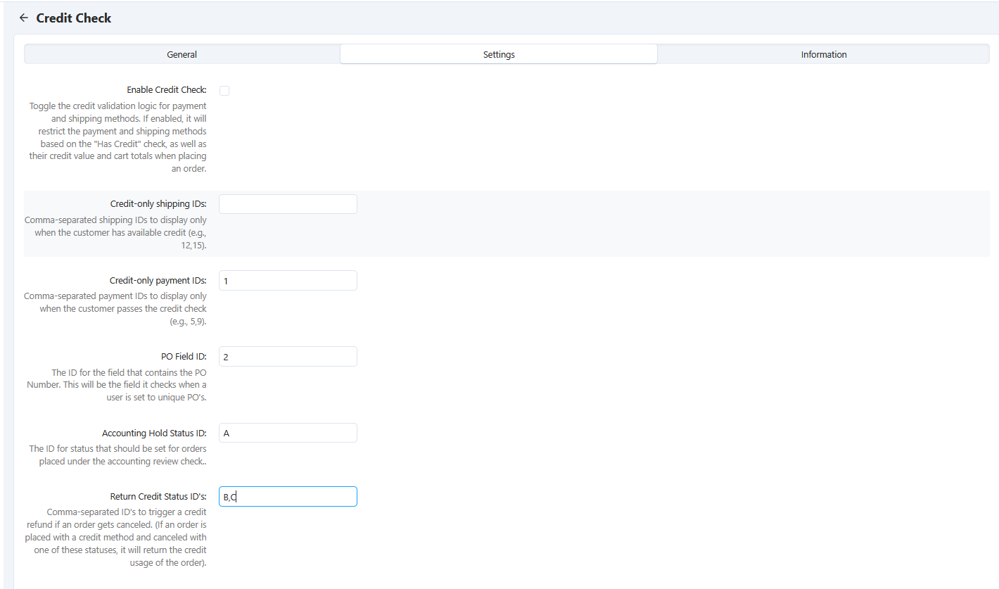
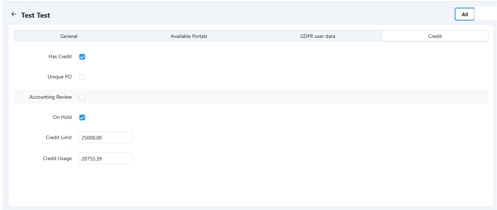
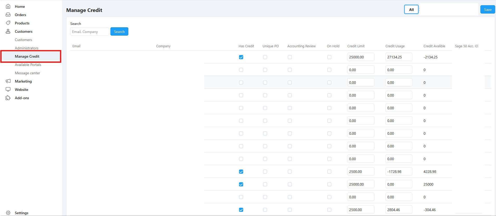

# Addon & Software Engineering Portfolio

A collection of custom software solutions, platform extensions, integrations, and application components developed to extend platform capabilities, automate workflows, and solve complex technical challenges while maintaining scalability, security, and long-term maintainability.

## Core Responsibilities

- Software Architecture
- Application Development
- Addon Development
- Systems Integration
- API Development
- Database Design
- Business Rule Automation
- Legacy System Modernization
- Platform Extensibility
- Technical Documentation

## Featured Projects

## Integration Engineering

### 01. Sage 50 Credit Synchronization Framework

#### Engineering Challenge

Customer credit information existed within a legacy ERP environment requiring 32-bit ODBC connectivity while eCommerce operations required access to synchronized customer credit status.

#### Technical Solution
- Developed PowerShell synchronization processes.
- Built ODBC and Access integration layers.
- Implemented customer credit validation logic.
- Developed automated update and monitoring routines.
- Created fault-tolerant synchronization workflows.
 
#### Screenshots
 
##### Addon Settings
 

 
##### Backend Customer Management
 

 
##### Backend Bulk Update Interface
 

 
##### Frontend Customer Experience
 

#### Technologies Used
- PowerShell
- Sage 50
- ODBC
- Microsoft Access
- SQL Server
- PHP

#### Technical Challenges
- Legacy 32-bit ERP architecture.
- Synchronization reliability.
- Data transformation and validation.
- Error handling and recovery.

#### Results
- Automated customer credit synchronization.
- Reduced administrative maintenance.
- Improved data accuracy.
- Established reusable integration framework.

## CS-Cart Addon Engineering

### 02. Customer Hierarchy Addon

#### Engineering Challenge
The platform did not provide a native method for creating parent-child customer relationships. The solution required secure account linking, permission enforcement, and controlled visibility of customer orders while preventing unauthorized access to data.

#### Technical Solution
- Designed a custom customer hierarchy architecture using parent-child relationships.
- Developed backend administrative interfaces for hierarchy management.
- Implemented permission validation throughout order and account workflows.
- Created secure customer visibility filtering based on relationship ownership.
- Added controlled order access for parent accounts.
- Developed reusable helper functions for hierarchy validation and access control.

#### Technologies Used
- PHP
- CS-Cart Addon Framework
- MySQL
- Smarty Templates
- JavaScript

#### Technical Challenges
- Preventing hierarchy spoofing and unauthorized access.
- Maintaining compatibility with native customer permissions.
- Integrating hierarchy validation throughout existing platform workflows.
- Supporting scalability without performance degradation.

#### Results
- Delivered secure parent-child customer relationships.
- Extended platform account management capabilities.
- Maintained full upgrade compatibility.
- Established reusable access-control patterns for future development.

### 03. Ship By Date Addon

#### Engineering Challenge
Order fulfillment workflows required shipment scheduling functionality that was not available within the native platform. The solution needed to support backend editing, searching, filtering, reporting, and document generation.

#### Technical Solution
- Extended order data structures with custom shipment scheduling fields.
- Developed administrative user interfaces for date management.
- Integrated custom data into order management workflows.
- Added search, filtering, and reporting support.
- Created invoice and document template integrations.
- Implemented validation throughout order lifecycle operations.

#### Technologies Used
- PHP
- MySQL
- Smarty Templates
- CS-Cart Hooks
- JavaScript

#### Technical Challenges
- Maintaining data consistency across multiple order workflows.
- Integrating custom fields into native search systems.
- Supporting administrative editing while preserving data integrity.
- Ensuring compatibility with document generation functionality.

#### Results
- Expanded order management capabilities.
- Improved fulfillment scheduling visibility.
- Maintained upgrade-safe implementation.
- Created reusable order metadata framework.

### 04. Automated Order Status Assignment Engine

#### Engineering Challenge
Complex fulfillment processes required order statuses to be automatically assigned based on shipping methods and configurable business rules. Native order processing workflows lacked this flexibility.

#### Technical Solution
- Developed a rules-based automation engine.
- Created configurable administrative interfaces for rule management.
- Implemented shipping method mapping and order status logic.
- Designed custom database structures for rule storage.
- Built execution and validation processes during order updates.

#### Technologies Used
- PHP
- MySQL
- CS-Cart Addon Framework
- Smarty Templates

#### Technical Challenges
- Creating flexible rule management without code changes.
- Handling conflicting rule conditions.
- Maintaining performance during order processing.
- Integrating with native order workflows.

#### Results
- Automated status assignment processes.
- Reduced manual order management.
- Increased workflow consistency.
- Established reusable rule-engine architecture.

### 05. Shipping Surcharge Automation Engine

#### Engineering Challenge
Shipping costs required dynamic surcharge calculations with custom tax handling and storefront-specific exclusions not supported by native platform functionality.

#### Technical Solution
- Developed custom shipping calculation logic.
- Created surcharge tracking and storage mechanisms.
- Implemented tax-aware calculations.
- Extended checkout and administrative order interfaces.
- Added storefront exclusion management.
- Built audit and reporting functionality for surcharge visibility.

#### Technologies Used
- PHP
- MySQL
- CS-Cart Hooks
- JavaScript
- Smarty Templates

#### Technical Challenges
- Maintaining calculation accuracy.
- Preserving compatibility with tax calculations.
- Synchronizing frontend and backend totals.
- Preventing conflicts with native shipping workflows.

#### Results
- Automated complex shipping calculations.
- Improved pricing transparency.
- Reduced manual adjustments.
- Maintained seamless checkout experiences.

## Workflow Automation Engineering

### 06. Backend Quantity Bypass Addon

#### Engineering Challenge
Administrative users required the ability to bypass minimum quantity and quantity-step restrictions during backend order creation without affecting storefront validation or customer purchasing rules.

#### Technical Solution
- Developed backend-only validation bypass controls.
- Implemented configurable administrative interfaces.
- Extended order update workflows.
- Preserved storefront validation logic.
- Added secure state management during recalculation operations.

#### Technologies Used
- PHP
- JavaScript
- CS-Cart Hooks
- Smarty Templates
- MySQL

#### Technical Challenges
- Separating administrative and storefront behavior.
- Maintaining checkbox state through recalculation events.
- Integrating with existing validation workflows.
- Preserving upgrade compatibility.

#### Results

- Enabled exception-based order processing.
- Reduced administrative workarounds.
- Maintained customer-facing validation rules.
- Extended backend workflow flexibility.
